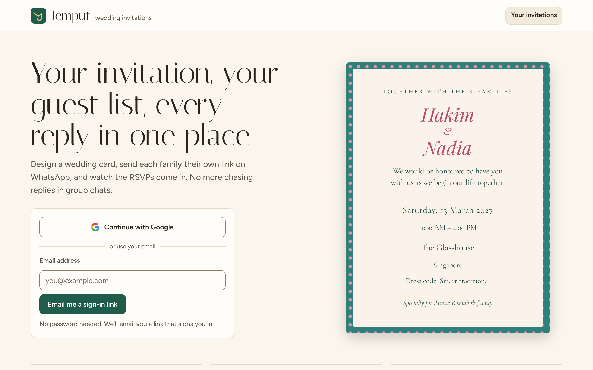
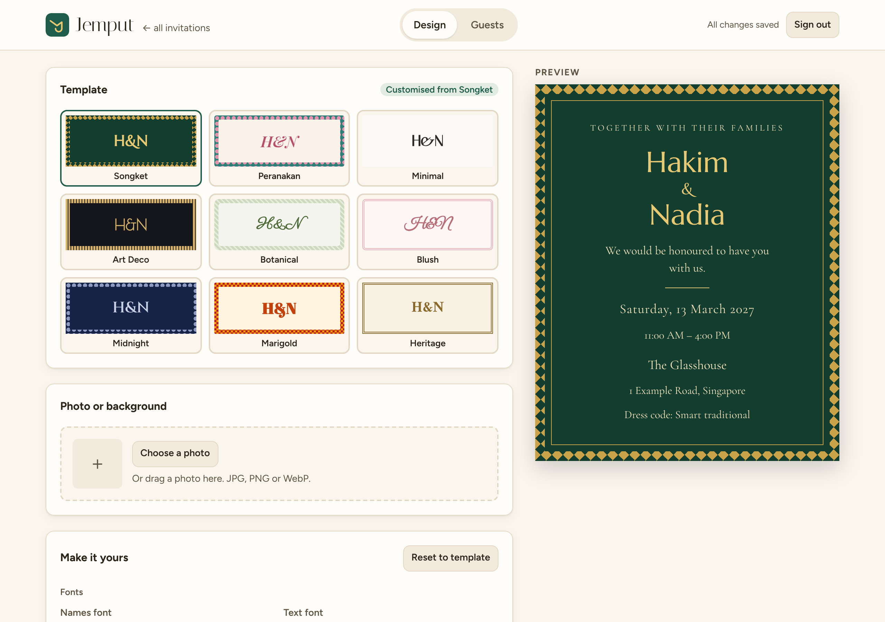
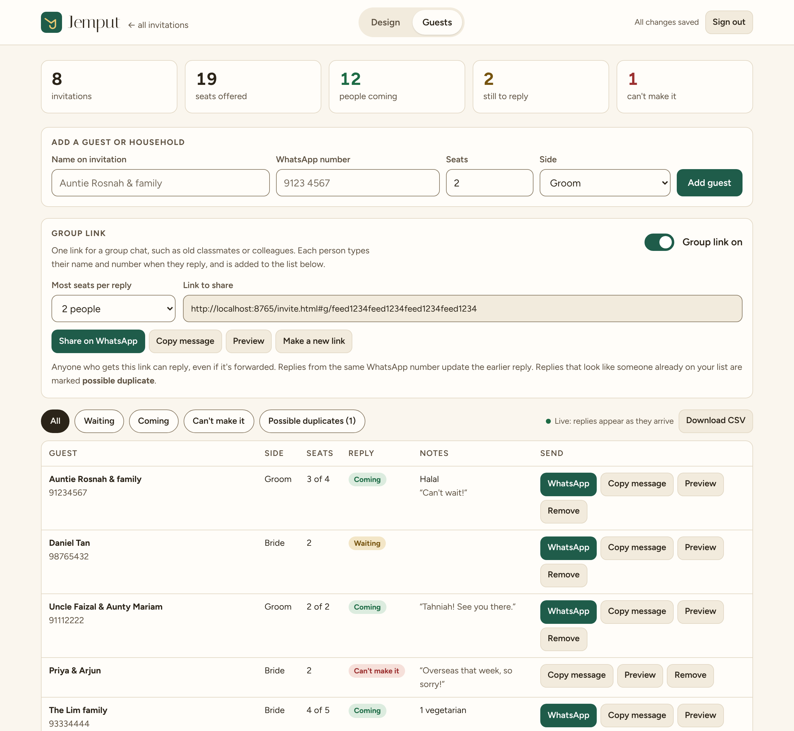
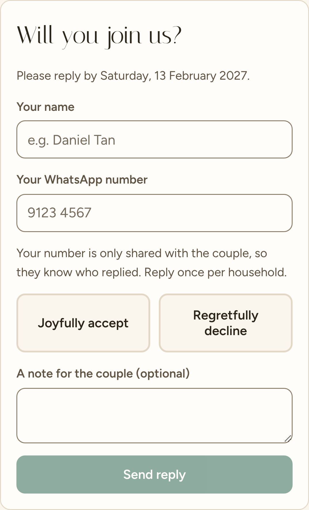
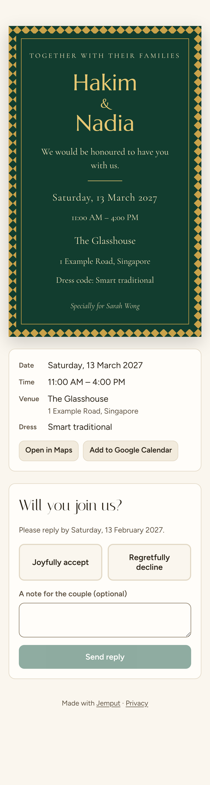
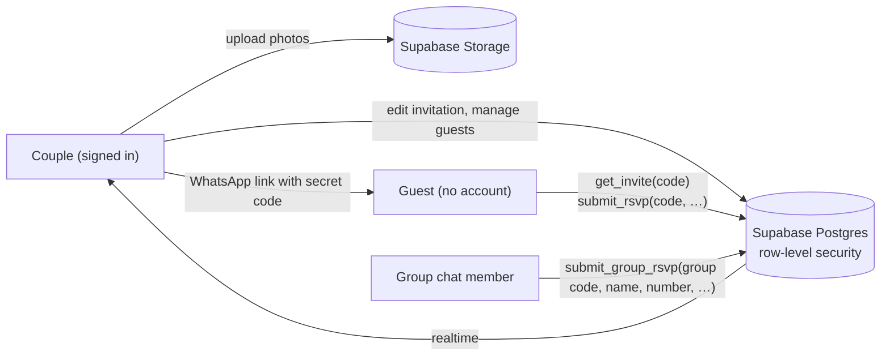

# Jemput

**Invitations with a guest list built in,** for weddings, birthdays, aqiqahs, open houses and more. Hosts design an invitation, send each household a personal link on WhatsApp, and watch RSVPs arrive live. Guests never need an account.

*Jemput* is Malay for "to invite".

**[Live site →](https://jemput2.netlify.app)** · [Set it up yourself](docs/SETUP.md)



## Why I built it

Canva can design a card, but it doesn't help with the hard part of a wedding in Singapore: chasing replies from a few hundred relatives over WhatsApp, tracking plus-ones and dietary needs, and knowing which side of the family each guest is on. Jemput treats the invitation as the front end of a guest list.

## Features

| | |
|---|---|
|  | **Design editor**<br>Eight occasions, each with its own wording, and fifteen templates (Songket, Peranakan, Confetti, Festive and more). Sixteen fonts, colour pickers, border patterns, and photos you can place above, below, left or right of the text, or as the background, then drag, zoom and frame. On phones the preview stays pinned while you edit. Saved templates can be reused across invitations. Changes save automatically. |
|  | **Guest list**<br>Add households with seats and family side, send each one a pre-written WhatsApp message with their own link, see totals at a glance, and export to CSV for the caterer. New replies appear without refreshing. |
|  | **Group links**<br>One link for a group chat, such as old classmates. Each person enters their name and WhatsApp number and is added to the guest list. Replying again from the same number updates the earlier reply. Replies that match someone already on the list by number or name are flagged as possible duplicates, and a group reply can never overwrite a personal guest's answer. |
|  | **Guest page**<br>Each guest sees the card with their name on it, Maps and calendar buttons, and an RSVP form limited to the seats they were given. No sign-up needed. |

## Tech stack

- **Front end:** plain HTML, CSS and JavaScript modules. No framework and no build step.
- **Back end:** [Supabase](https://supabase.com) for the Postgres database, row-level security, email and Google sign-in, file storage and realtime updates.
- **Hosting:** Netlify, as static files.
- **Accessibility:** a warm cream palette where every text and control colour meets WCAG AA contrast in light and dark mode, 16px base text, 44px tap targets and visible focus rings.

## How it works



- **Couples only ever see their own data.** Every table has a row-level security policy tying rows to `auth.uid()`, so the database itself refuses other users. It doesn't depend on the front end behaving.
- **Guests get a capability link, not an account.** Each guest row has a random 128-bit code. Guests can't query tables at all. They can only call two `SECURITY DEFINER` functions, which take the code and return or update that one guest's row. The reply function checks the answer and caps the head-count at the seats offered.
- **Group links** go through a third function that matches replies by normalised phone number (+65 added to 8-digit numbers), updates an existing group reply instead of duplicating it, and flags rather than merges anything that matches a personal guest. The guest's phone remembers its reply locally, so reopening the link shows the answer rather than a blank form.
- **Photos** are resized in the browser before upload, stored under `<user-id>/<invitation-id>/`, and protected by storage policies on that folder.
- **The card renderer** (`js/card.js`) is shared by the editor, the dashboard and the guest page, so every view matches. All user text is HTML-escaped, and all stored styles are re-validated before rendering.

## Problems worth mentioning

- **Positioning a photo in any frame shape.** Moving the photo with `object-position` only works along the axis where the photo overflows the frame, so up/down did nothing for a wide photo in a tall arch. I switched to CSS container query units: the image is sized from the frame (`max(100cqw, 100cqh × aspect)`) and translated by a percentage of it. That gives zoom below 100%, free dragging in both directions, and a "fit frame to photo" button.
- **Links that broke on real hosting.** Some static hosts rewrite `edit.html?id=…` to `/edit` and drop the query string. Invitation IDs and guest codes now live in the URL fragment (`#…`), which is never sent to the server, and older `?id=` links still work.
- **Forgiving setup.** People paste their Supabase URL with a trailing slash, `/rest/v1/`, or a dashboard link instead. `js/base-url.js` normalises all of these, so a copy-paste slip doesn't stop sign-in.
- **Free-tier realities.** A scheduled ping (`.github/workflows/keep-awake.yml`) stops the free database from pausing, which would otherwise break guest links in the middle of RSVP season.

## Project structure

```
index.html      landing page and sign-in
app.html        dashboard: your invitations
edit.html       editor: Design and Guests tabs
invite.html     the page a guest opens
privacy.html    privacy policy
js/card.js      templates, fonts and card rendering (shared)
js/edit.js      editor logic
js/invite.js    guest page and RSVP
supabase/schema.sql   tables, security policies, guest functions, storage
supabase/002_group_links.sql   update for installs made before group links
```

## Run it yourself

It takes about 15 minutes with free Supabase and Netlify accounts. See **[docs/SETUP.md](docs/SETUP.md)**.

## What's next

- Per-invitation WhatsApp link previews showing the couple's names and photo, using a small server function.
- Separate RSVPs for multiple events, such as the akad nikah, tea ceremony and reception.
- Converting iPhone HEIC photos in the browser.
- A one-tap reminder message to everyone who hasn't replied.

## Licence

MIT. See [LICENSE](LICENSE).